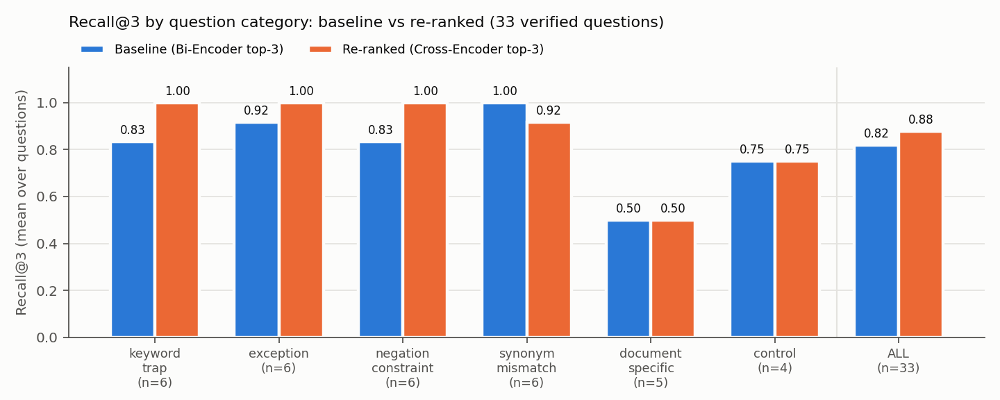
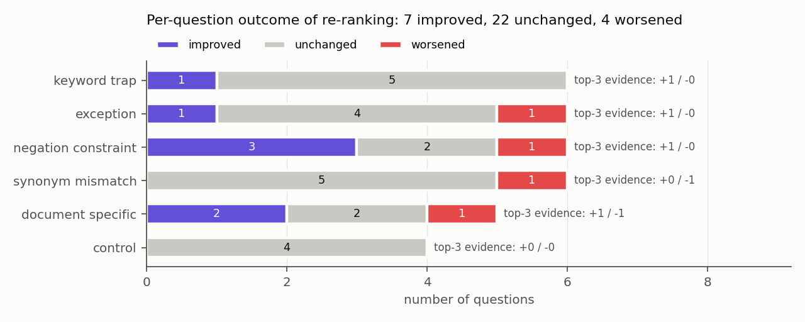
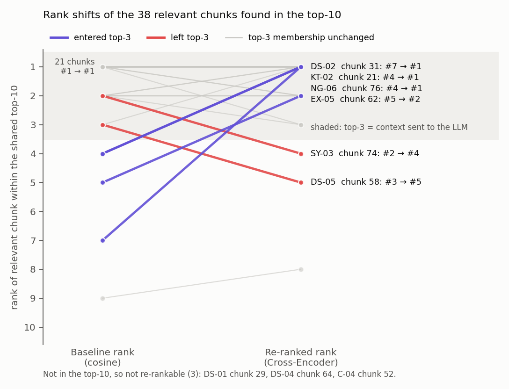
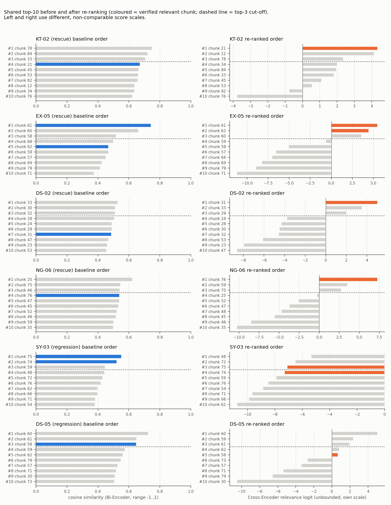
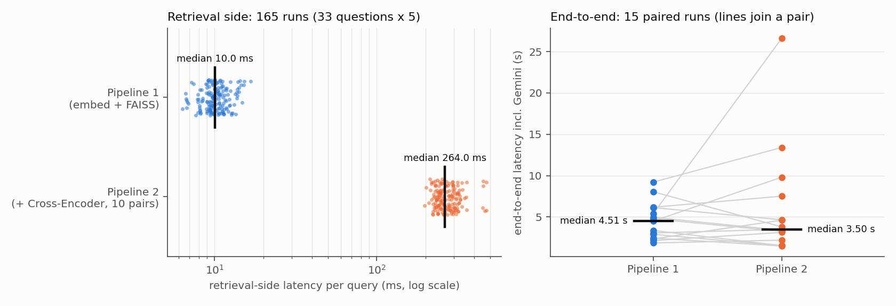
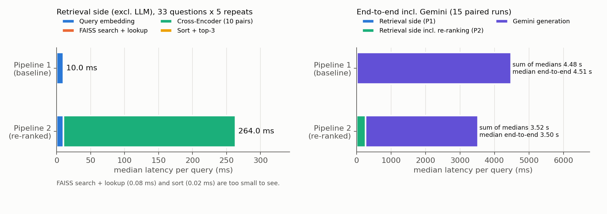
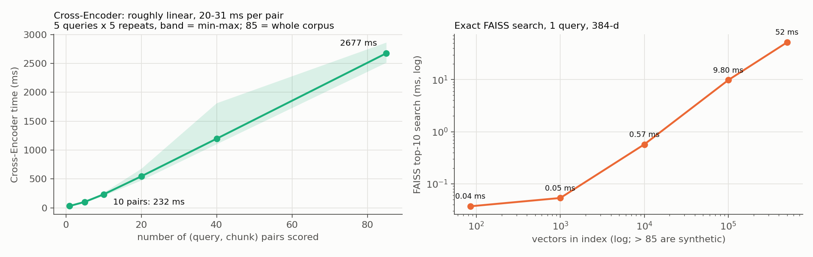

# Results summary: Baseline RAG vs Cross-Encoder re-ranking

Every number, table and figure below was generated from the saved experiment outputs (Tasks 4-6), after the validation checks listed at the end. The answer verdicts (correct / partially correct / insufficient context) and the short interpretive sentences come from the manual review of the actual Gemini answers (`MANUAL_REVIEW` in the notebook).

## Configuration

- **Source:** `document.pdf`, IIT Madras B.Tech Ordinances & Regulations, 25 pages
- **Chunking:** RecursiveCharacterTextSplitter, 1000 chars, overlap 200 → 85 chunks
- **Bi-Encoder:** `sentence-transformers/all-MiniLM-L6-v2`; FAISS `IndexFlatIP` on L2-normalised vectors (= cosine similarity), top-10
- **Cross-Encoder:** `cross-encoder/ms-marco-MiniLM-L-6-v2`. It re-scores exactly the same top-10; top-3 go to the LLM
- **LLM:** `gemini-2.5-flash`. Settings {"temperature": 0.0, "top_p": 1.0, "max_output_tokens": 8192, "seed": 42}, and one prompt template shared by both pipelines
- **Evaluation set:** 33 questions, verified against the PDF, in 6 categories; relevance labels = chunks that contain the evidence quotes
- **Hardware:** 12th Gen Intel(R) Core(TM) i5-1235U, 15.3 GB RAM, GPU: none (CPU only)

## Retrieval metrics (all 33 questions)

| | Recall@3 | Hit@3 | MRR@10 | Evidence coverage@3 |
|---|---|---|---|---|
| Baseline | 0.818 | 0.848 | 0.801 | 0.836 |
| Re-ranked | 0.879 | 0.909 | 0.863 | 0.894 |

- **Shared candidate pool:** Recall@10 = 0.939, identical for both pipelines. No relevant chunk reached the top-10 for: C-04.
- **Chunks moved:** 4 relevant chunks were promoted from ranks 4-10 into the top-3, and 2 were demoted out of it.
- **Per-question outcome:** 7 improved, 22 unchanged, 4 worsened.
  - Only 4 improvements (KT-02, EX-05, NG-06, DS-02) and 2 regressions (SY-03, DS-05) changed the evidence that reaches the LLM.
  - The rest are rank moves only, e.g. a chunk moving within the top-3, or from #9 to #8.
- **Metric definitions:**
  - Recall@3 = |relevant ∩ top-3| / |relevant|.
  - MRR@10 = 1/rank of the first relevant chunk (0 if none).
  - Evidence coverage@3 = share of evidence quotes present in the top-3.

### By category

| category | n | base_recall@3 | rr_recall@3 | base_mrr@10 | rr_mrr@10 | base_evcov@3 | rr_evcov@3 |
|---|---|---|---|---|---|---|---|
| keyword_trap | 6 | 0.833 | 1.000 | 0.875 | 1.000 | 0.833 | 1.000 |
| exception | 6 | 0.917 | 1.000 | 0.917 | 0.889 | 0.933 | 1.000 |
| negation_constraint | 6 | 0.833 | 1.000 | 0.681 | 0.917 | 0.833 | 1.000 |
| synonym_mismatch | 6 | 1.000 | 0.917 | 1.000 | 0.889 | 1.000 | 0.917 |
| document_specific | 5 | 0.500 | 0.500 | 0.517 | 0.665 | 0.600 | 0.600 |
| control | 4 | 0.750 | 0.750 | 0.750 | 0.750 | 0.750 | 0.750 |
| ALL | 33 | 0.818 | 0.879 | 0.801 | 0.863 | 0.836 | 0.894 |

## Confirmed rescues and regressions

A **rescue** means: relevant evidence missing from the baseline top-3 was in the baseline top-10 and was promoted into the top-3 by the Cross-Encoder. Cosine similarities and Cross-Encoder logits are on different scales, so only ranks are compared across pipelines.

- **KT-02** (keyword_trap, strict rescue): chunk 21 #4→#1.
  - Top-3: [78, 84, 33] → [21, 12, 78].
  - Evidence coverage 0.00 → 1.00.
  - Scores: chunk 21: cosine 0.673, CE logit 4.33.
  - Answer 1: *insufficient_context*. Answer 2: *correct*. Answer change: **improved**.
- **EX-05** (exception, rescue): chunk 61 #1→#1, chunk 62 #5→#2.
  - Top-3: [61, 60, 58] → [61, 62, 60].
  - Evidence coverage 0.60 → 1.00.
  - Scores: chunk 61: cosine 0.743, CE logit 5.49; chunk 62: cosine 0.469, CE logit 4.46.
  - Answer 1: *partially_correct*. Answer 2: *correct*. Answer change: **improved**.
- **DS-02** (document_specific, strict rescue): chunk 31 #7→#1.
  - Top-3: [33, 30, 32] → [31, 33, 29].
  - Evidence coverage 0.00 → 1.00.
  - Scores: chunk 31: cosine 0.488, CE logit 5.03.
  - Answer 1: *insufficient_context*. Answer 2: *correct*. Answer change: **improved**.
- **NG-06** (negation_constraint, strict rescue): chunk 76 #4→#1.
  - Top-3: [25, 75, 46] → [76, 59, 75].
  - Evidence coverage 0.00 → 1.00.
  - Scores: chunk 76: cosine 0.540, CE logit 7.29.
  - Answer 1: *insufficient_context*. Answer 2: *correct*. Answer change: **improved**.
- **SY-03** (synonym_mismatch, regression): chunk 74 #2→#4, chunk 75 #1→#3.
  - Top-3: [75, 74, 59] → [48, 72, 75].
  - Evidence coverage 1.00 → 0.50.
  - Scores: chunk 74: cosine 0.522, CE logit -7.31; chunk 75: cosine 0.553, CE logit -7.11.
  - Answer 1: *correct*. Answer 2: *insufficient_context*. Answer change: **worsened**.
- **DS-05** (document_specific, regression): chunk 58 #3→#5.
  - Top-3: [60, 61, 58] → [60, 59, 61].
  - Evidence coverage 1.00 → 0.00.
  - Scores: chunk 58: cosine 0.649, CE logit 0.67.
  - Answer 1: *correct*. Answer 2: *insufficient_context*. Answer change: **worsened**.

| query_id | category | relevant_rank_shifts | baseline_top3 | reranked_top3 | base_evcov@3 | rr_evcov@3 | rescue | strict_rescue | answer_1_verdict | answer_2_verdict | answer_change |
|---|---|---|---|---|---|---|---|---|---|---|---|
| KT-02 | keyword_trap | chunk 21: #4 -> #1 | [78, 84, 33] | [21, 12, 78] | 0.00 | 1.00 | True | True | insufficient_context | correct | improved |
| EX-05 | exception | chunk 61: #1 -> #1; chunk 62: #5 -> #2 | [61, 60, 58] | [61, 62, 60] | 0.60 | 1.00 | True | False | partially_correct | correct | improved |
| DS-02 | document_specific | chunk 31: #7 -> #1 | [33, 30, 32] | [31, 33, 29] | 0.00 | 1.00 | True | True | insufficient_context | correct | improved |
| NG-06 | negation_constraint | chunk 76: #4 -> #1 | [25, 75, 46] | [76, 59, 75] | 0.00 | 1.00 | True | True | insufficient_context | correct | improved |
| SY-03 | synonym_mismatch | chunk 74: #2 -> #4; chunk 75: #1 -> #3 | [75, 74, 59] | [48, 72, 75] | 1.00 | 0.50 | False | False | correct | insufficient_context | worsened |
| DS-05 | document_specific | chunk 58: #3 -> #5 | [60, 61, 58] | [60, 59, 61] | 1.00 | 0.00 | False | False | correct | insufficient_context | worsened |

## Answer changes (manual review of actual Gemini outputs)

- **Answers improved: KT-02, EX-05, DS-02, NG-06.** In every rescue, the baseline either declined for lack of evidence (KT-02, DS-02, NG-06) or left out the decisive clause (EX-05). The re-ranked answer was correct.
- **Negation case NG-06** was found by a retrieval-only screen of 24 negation phrasings (`stress_test/negation_screen.json`): 3 screen hits, 2 rejected on checking, 1 kept.
- **Answers worsened: SY-03, DS-05.** The key chunk dropped out of the top-3, and Answer 2 declined for lack of evidence.
- **Fabrications found:** 0. When evidence was missing, the model said so instead of guessing.
- **Citation errors:** one page-citation slip in the reviewed answers, a wrong page within a two-page chunk (NG-06 Answer 2).
- **Retrieval vs answer quality:** in all six cases the answer moved in the same direction as the retrieval change, i.e. with whether the deciding chunk was in the context.
- Full side-by-side answers: `tables/answers_side_by_side.md`.

### Repeated generation (5 runs per pipeline per case)

Each case was answered 5 times by both pipelines on the same backend (Vertex AI), with the same retrieval, prompt and settings. Verdicts were assigned after reading every answer. The key-fact column is an automatic regex check for the facts in the reference answer (patterns stored in `stress_test/generation_repeats.json`).

| Case | Answer 1 verdicts | Answer 2 verdicts | A1 with all key facts | A2 with all key facts |
|---|---|---|---|---|
| KT-02 | insufficient_context ×5 | correct ×5 | 0/5 | 5/5 |
| EX-05 | partially_correct ×5 | correct ×5 | 0/5 | 5/5 |
| DS-02 | insufficient_context ×5 | correct ×5 | 0/5 | 5/5 |
| NG-06 | insufficient_context ×5 | correct ×5 | 0/5 | 5/5 |
| SY-03 | correct ×5 | insufficient_context ×5 | 5/5 | 0/5 |
| DS-05 | correct ×5 | insufficient_context ×5 | 5/5 | 0/5 |

- The verdict was identical in all 5 runs for every case; only the wording changed (e.g. KT-02 Answer 2 quotes the conflicting O.5 clause in runs 2-3 only).
- Full runs: `stress_test/generation_repeats.json`; summary: `stress_test/generation_repeats_summary.csv`.

## Latency (ms unless stated)

| Component | n | mean | median | std |
|---|---|---|---|---|
| Query embedding (Bi-Encoder, 1 query) | 165 | 10.217 | 9.959 | 1.880 |
| FAISS top-10 search (85 vectors) | 165 | 0.068 | 0.069 | 0.020 |
| Cross-Encoder scoring (10 pairs) | 165 | 265.037 | 253.340 | 50.413 |
| Pipeline 2: sort by CE score + top-3 | 165 | 0.018 | 0.017 | 0.006 |
| Pipeline 1 retrieval side (total) | 165 | 10.298 | 10.039 | 1.886 |
| Pipeline 2 retrieval side (total) | 165 | 275.352 | 263.994 | 50.690 |
| Additional re-ranking time (CE + sort) | 165 | 265.055 | 253.357 | 50.413 |
| Gemini generation, Answer 1 (P1 context) | 15 | 4465.213 | 4473.500 | 2217.392 |
| Gemini generation, Answer 2 (P2 context) | 15 | 5745.780 | 3256.300 | 6600.380 |
| Pipeline 1 end-to-end | 15 | 4495.860 | 4510.400 | 2214.414 |
| Pipeline 2 end-to-end | 15 | 6034.640 | 3504.700 | 6591.336 |

- **Re-ranking cost:** it adds **265 ms** per query (mean), so the retrieval side is 26.7x slower (mean) and 26.3x slower (median).
- **End-to-end:** P2/P1 = 0.78x by median and 1.34x by mean.
  - Re-ranking is 4.4% of P2's mean end-to-end time.
  - Gemini latency varies strongly between identical requests (Answer 1: 1.8-9.2 s, Answer 2: 1.1-26.3 s), far more than the 265 ms re-ranking step, so the end-to-end ratios reflect Gemini variance. With 15 pairs, the end-to-end difference is not statistically resolved.
- **Cross-Encoder scaling:** 10 pairs = 232 ms; the whole 85-chunk corpus = 2677 ms per query.
  - Linear extrapolation: about 5 min per query for 10k chunks.
- **FAISS scaling:** exact search over 100k vectors (synthetic) = 9.8 ms.
- **Cost estimate:** ≈ $0.046 for 30 Gemini answers (assumed list prices).

## Limitations

- 33 questions, one PDF, one retrieval run per pipeline: the counts are indicative, not statistically significant. NG-06 was added after a retrieval-only screen of 24 negation phrasings (results/stress_test/negation_screen.json); 1 of the 3 screen hits survived checking, so the negation rescue was searched for, not found by chance.
- Answers were generated 5 times per pipeline for the six reviewed cases (60 Gemini calls, all on Vertex AI, the same backend as the latency benchmark). The verdict was the same in all 5 runs for every case; only the wording changed. Five runs show the pattern is stable, but cannot rule out rarer outcomes.
- Earlier single-run answers from the Gemini Developer API (a different backend) showed the same verdict pattern; they are not used in the results.
- Answer verdicts are a single reviewer's judgement against the verified reference answers, not an independent annotation. The automatic key-fact check (regexes stored in generation_repeats.json) agreed with every verdict, but it only tests whether key facts are mentioned.
- Relevance labels are the chunks containing the evidence quotes; a chunk that answers the question with different wording would not count as relevant.
- C-04 (control) failed for both pipelines: the 12-credit rule is the last sentence of chunk 52, which is mostly about contact courses, and chunk 52 is not in the top-10. Re-ranking cannot recover chunks outside the candidate pool (a chunking issue, not a ranking issue).
- DS-01 (free-elective credits, 2011-2012): the relevant table tail (chunk 30) stays at #8-#9; the table half without its batch caption is hard for both models. Recorded as 'improved (rank only)', which is not a meaningful gain.
- Latency was measured on one laptop CPU without a GPU. Gemini latency includes network and server queueing, and Vertex AI returned transient 429 errors, which were retried and are excluded from the measurements.
- All reviewed answers (and their 5-run repeats) and the Gemini latency runs used one backend: Vertex AI (project=lma-ass1, location=global), model gemini-2.5-flash, identical settings.
- Retrieval metrics depend on the relevance labels (chunks containing the evidence quotes). Chunk overlap means some quotes occur in two chunks.

## Validation of the inputs

19/19 checks passed.

- PASS: 33 questions, unique query IDs
- PASS: no duplicate question texts
- PASS: no missing values in question fields
- PASS: all relevant/distractor chunk IDs exist in chunks.json
- PASS: relevant and distractor labels disjoint
- PASS: all questions verified against the PDF (Task 4 flag)
- PASS: categories are the six defined ones
- PASS: one retrieval row per question
- PASS: retrieval run used the current chunk corpus (fingerprint)
- PASS: retrieval candidates, ranks and Recall@3/MRR@10/evidence coverage recomputed and match
- PASS: generated answers: present, same top-3 as retrieval run, fairness checks passed
- PASS: every generated case has a manual review
- PASS: repeat runs: 5 per case, fairness checks passed, verdicts agree with the key-fact check
- PASS: all reviewed answers and the Gemini latency runs used one backend
- PASS: retrieval timings: 165 rows = 33 questions x 5 repeats, no missing values
- PASS: generation timings: 15 completed pairs, unique (query, repeat), no missing values
- PASS: generation settings identical in every completed pair
- PASS: latency summary means recomputed from raw files and match
- PASS: attempt log consistent (successful calls >= 2 x completed pairs)

## Files

- `tables/`:
  - `recall_summary`
  - `outcome_counts`
  - `rank_shifts_relevant_chunks`
  - `rescues_and_regressions`
  - `latency_comparison` (.csv + .md)
  - `answers_side_by_side.md`
- `figures/`:
  - `recall_at3_by_category.png`
  - `outcome_counts_by_category.png`
  - `rank_shifts_relevant_chunks.png`
  - `top10_before_after.png`
  - `latency_comparison.png`
  - `latency_breakdown.png`
  - `latency_scaling.png`
- Raw sources: `stress_test/`, `latency/`, `../data/evaluation/questions.json`
